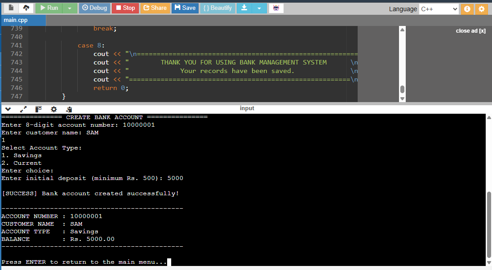
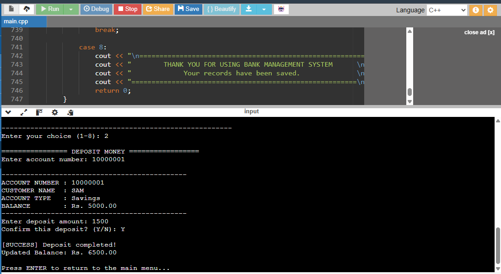
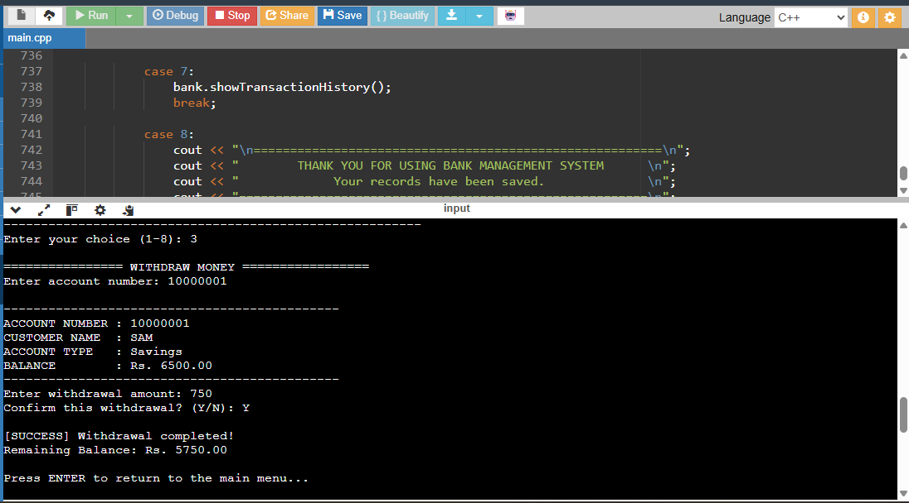
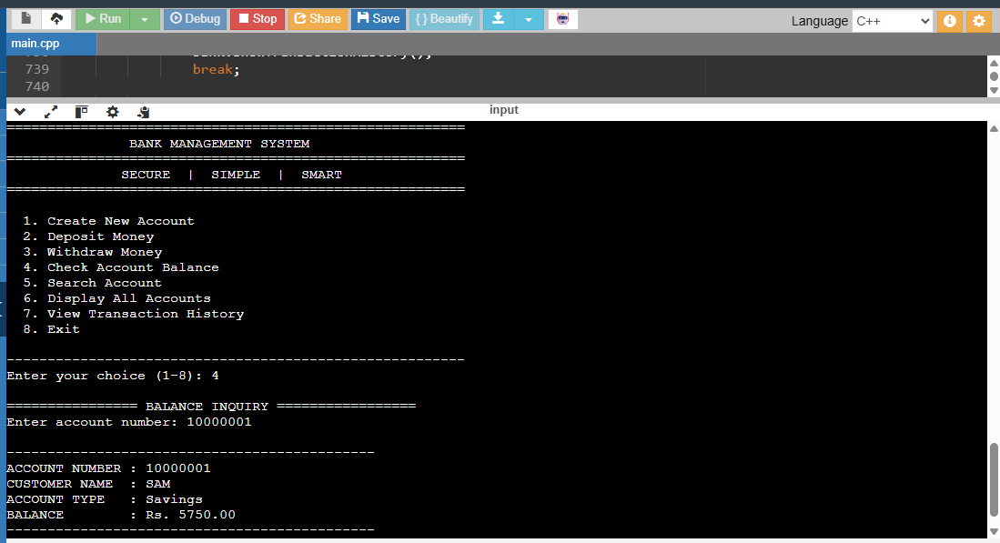
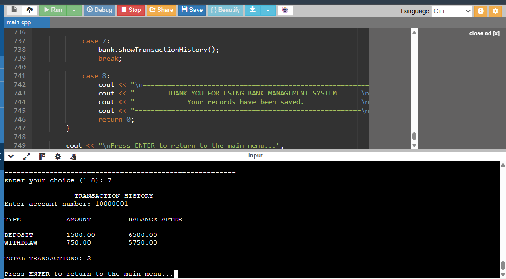
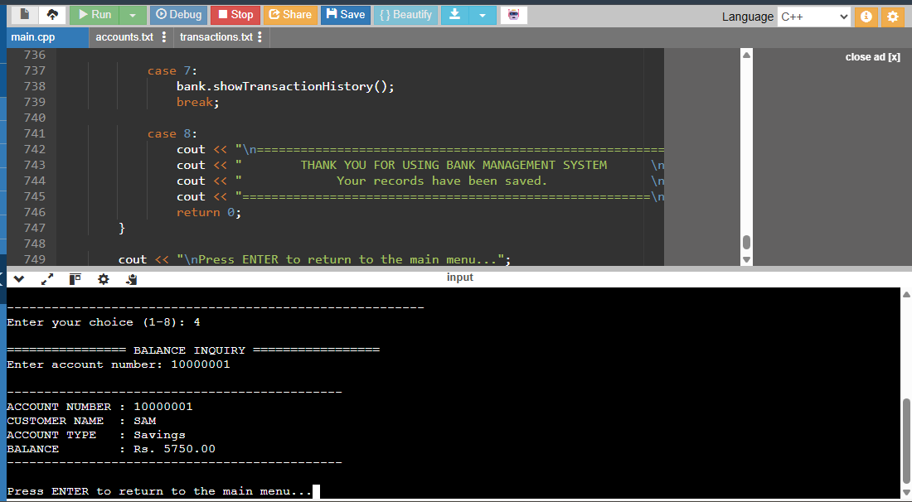

# 🏦 Bank Management System

A console-based **Bank Management System** developed using C++. This project simulates basic banking operations while demonstrating Object-Oriented Programming (OOP), file handling, and data management.

## 📌 Project Overview

The Bank Management System allows users to create and manage bank accounts, perform deposits and withdrawals, check account balances, and view transaction histories.

Customer account information and transaction records are stored in local files to maintain data between program executions.

## ✨ Features

- **Create Account:** Create a new bank account with customer details and an initial deposit.
- **Deposit Money:** Add money to an existing account.
- **Withdraw Money:** Withdraw funds while checking the available balance.
- **Check Balance:** View the current balance of an account.
- **Search Account:** Find an account using its account number.
- **Display All Accounts:** View the available customer accounts.
- **Transaction History:** View recorded deposits and withdrawals.
- **Data Persistence:** Save and load account and transaction information using files.
- **Input Validation:** Handle invalid inputs and prevent certain incorrect banking operations.

## 🛠️ Technologies Used

- **Programming Language:** C++
- **Concepts:** Object-Oriented Programming (OOP)
- **File Handling:** C++ file streams
- **Data Structures:** Classes and vectors
- **Development Environment:** OnlineGDB

## 🧠 OOP Concepts Demonstrated

This project demonstrates important object-oriented programming concepts:

- **Encapsulation:** Account data is kept private and accessed through class methods.
- **Classes and Objects:** Separate classes are used to represent accounts, transactions, and the bank.
- **Member Functions:** Banking operations are implemented through class methods.
- **Data Management:** Vectors are used to manage account and transaction records.

## 📂 Project Structure

```text
bank-management-system/
│
├── main.cpp
├── accounts.txt
├── transactions.txt
└── README.md
```

**Note:** The account and transaction files are created locally by the program when data is saved. They may not appear in the GitHub repository initially.

## ▶️ How to Run

1. Clone or download this repository.
2. Open the project in a C++ compiler or IDE.
3. Compile `main.cpp` using a C++11-compatible compiler.
4. Run the generated executable.

### Compile using g++

```bash
g++ -std=c++11 main.cpp -o bank
```

### Run

**Windows:**
```bash
bank.exe
```

**Linux / macOS:**
```bash
./bank
```

## 💾 Data Storage

The application uses local text files to preserve information:

- `accounts.txt` — Stores customer account information.
- `transactions.txt` — Stores transaction records.

This allows account information and transaction history to remain available when the application is restarted.

**Important:** This is an educational banking simulation. Data is stored in plain text and does not include the security, encryption, authentication, or safeguards required by real banking systems. Use fictional information only.

## 📸 Application Screenshots

### 1. Account Creation


### 2. Deposit Transaction


### 3. Withdrawal Transaction


### 4. Balance Inquiry


### 5. Transaction History


### 6. Data Persistence


## 🎯 Learning Outcomes

Through this project, I practised:

- Implementing Object-Oriented Programming in C++.
- Designing and working with multiple classes.
- Using vectors to manage records.
- Reading and writing data using file handling.
- Implementing basic banking operations.
- Applying input validation and basic error handling.
- Organising a console-based application.

## 👩‍💻 Author

**Preetha Maria Rosalind Subramani**

GitHub: [@preetha-codes](https://github.com/preetha-codes)
